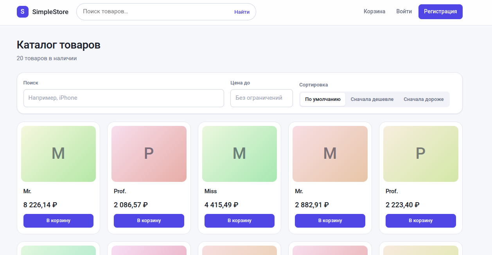
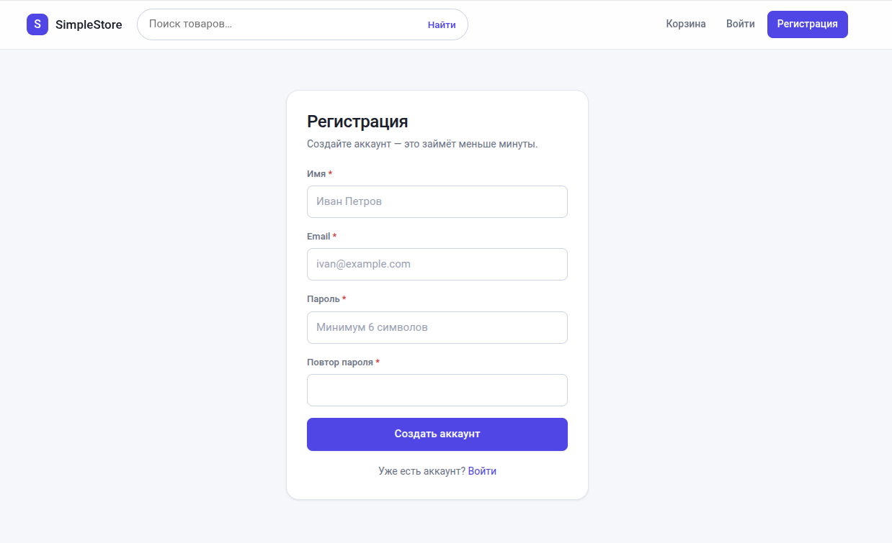
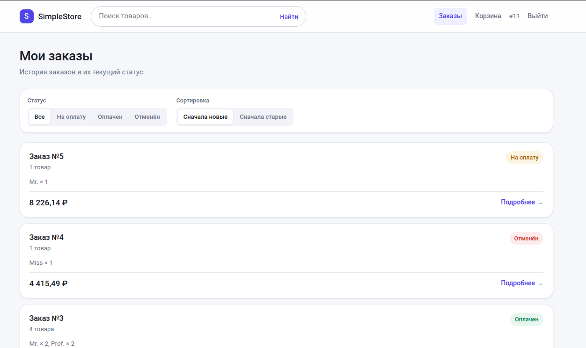

# Simple Store — клиент интернет-магазина

Используется для демонстрации навыков. 

Простой интернет магазин, сервером которого выступает данный репозиторий:


- [https://github.com/CrazyYakov/flag_test_work]
- [https://github.com/CrazyYakov/flag_test_work]
- [https://github.com/CrazyYakov/flag_test_work]


## Стек технологии

- Vite 8.
- Vue 3.
- TypeScript.

## Установка

```bash
npm install
```

API-запросы идут на `/api` и проксируются Vite на адрес из переменной
`VITE_API_TARGET` в файле `.env` (по умолчанию `http://localhost:8000`).
Если бэкенд поднят по другому адресу — поменяйте значение в `.env`
и перезапустите `npm run dev`. Образец настроек — в `.env.example`.

## Сборка и проверка типов

```bash
npm run build      # vue-tsc --build + vite build
npm run preview
```

## Структура

- `src/api` — типизированный клиент API на `fetch` (Bearer-токен из `localStorage`,
 разбор `401`/`404`/`422`, событие `shop:auth-expired` при истёкшей сессии)
- `src/stores` — состояние на composables: `auth`, `cart`, `toast`
- `src/router` — маршруты и редиректы для защищённых страниц
- `src/views` — страницы: каталог, товар, корзина, заказы, вход, регистрация
- `src/components/ui` — базовые UI-компоненты, дизайн-система в `src/assets`

## Основные сценарии

1. Каталог: поиск (`search`), сортировка по цене (`sort_price_dir`), фильтр по цене.
2. Карточка товара → добавление в корзину.
3. Корзина: количество, удаление, выбор способа оплаты (`/api/payment/methods`),
   оплата через `POST /api/carts/pay/{id}` с переходом по ссылке, если API её вернул.
4. Заказы: список с фильтром по статусу и сортировкой по дате, детали заказа,
   «отметить оплаченным» (`POST /api/orders/payed/{id}`).

## Результат

### Основная страница товаров



### Регистрация пользователя



### Заказы пользователя

